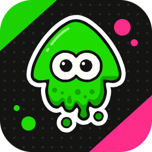
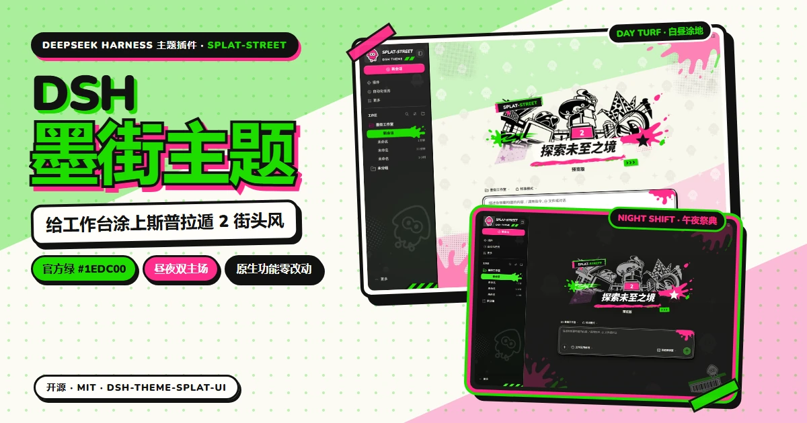
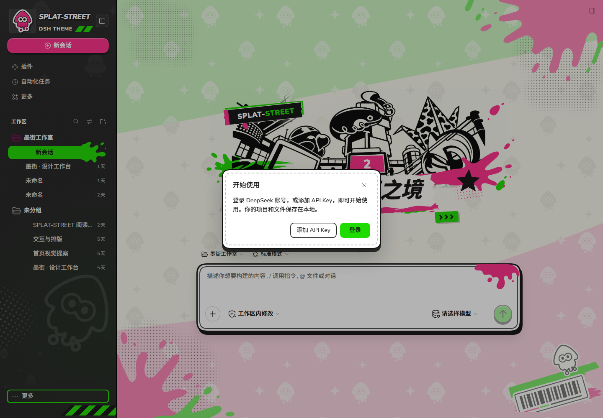
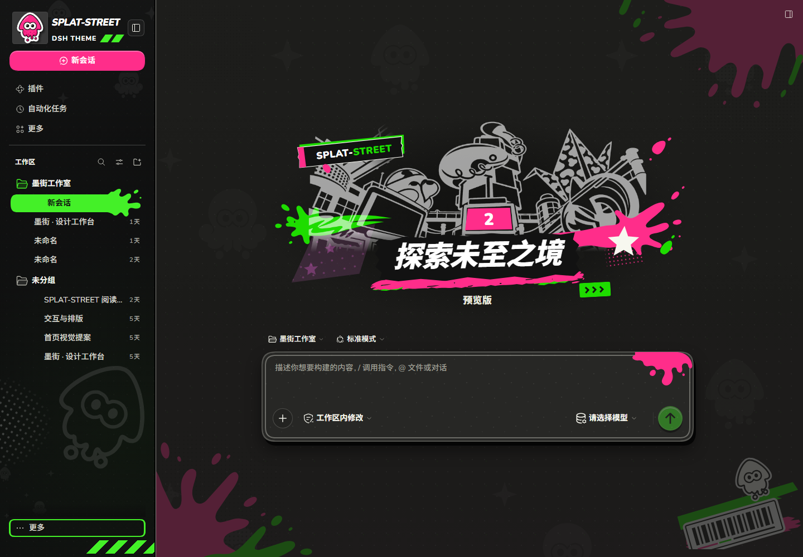
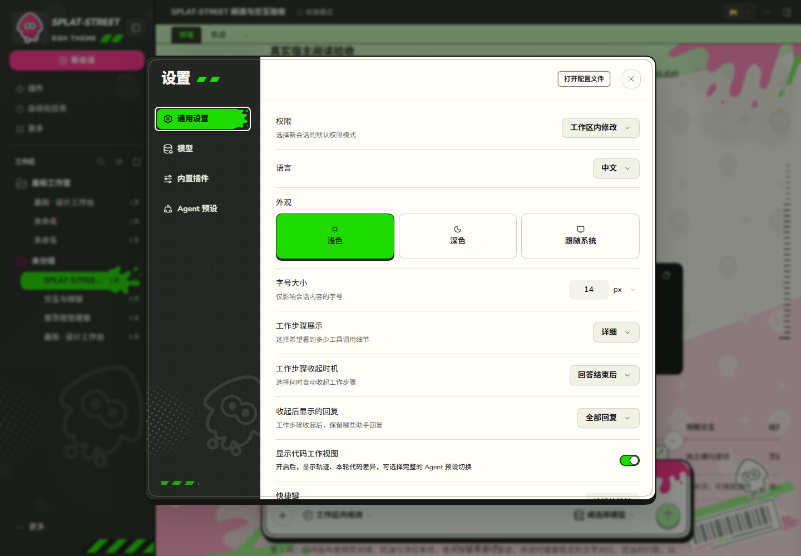
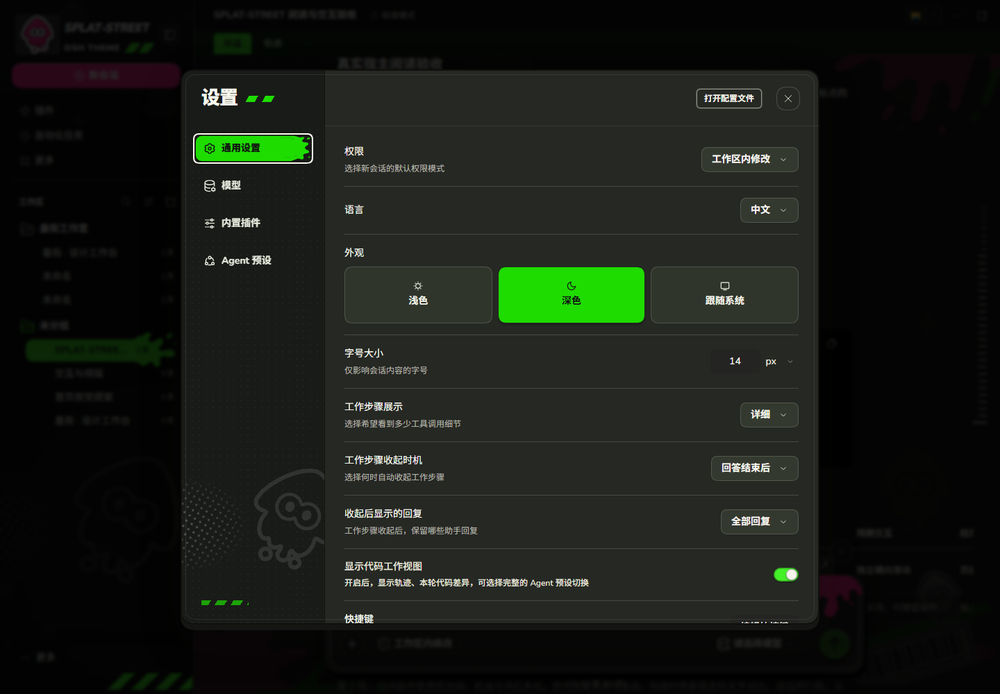
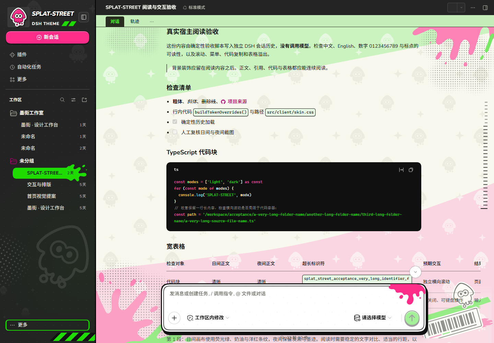
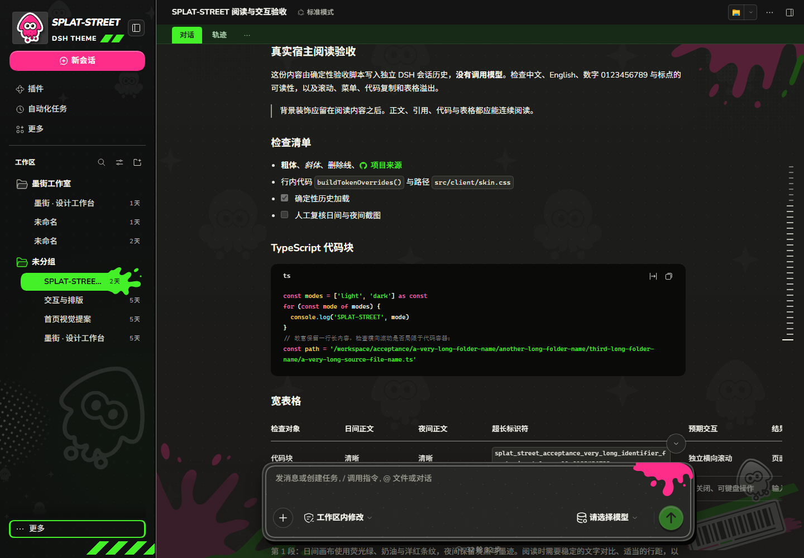
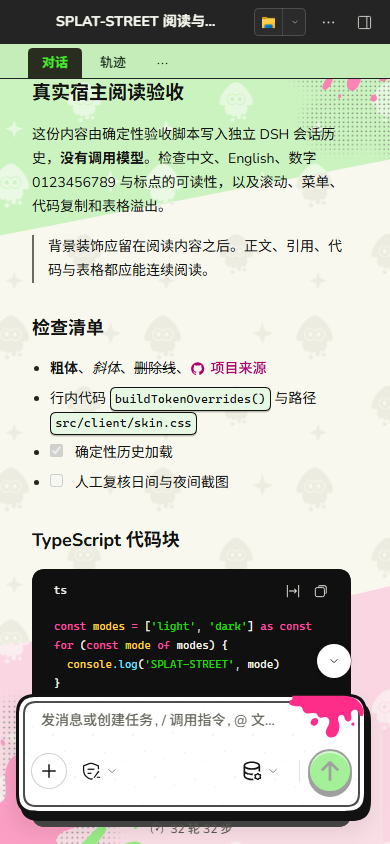
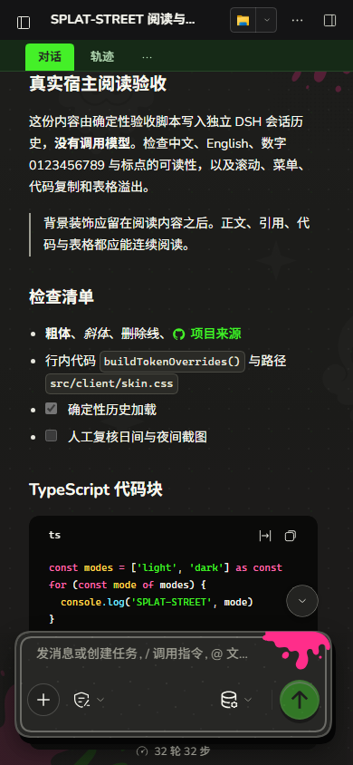

<div align="center">



# SPLAT-STREET · DSH テーマ

[English](README.md) · [简体中文](README.zh.md) · **日本語** · [한국어](README.ko.md) · [ショーケース＆実機デモ](https://shirolin.github.io/dsh-theme-splat-ui/) · 作者：[Shirolin](https://github.com/Shirolin)

[](https://github.com/Shirolin/dsh-theme-splat-ui/actions/workflows/check.yml)
[](https://shirolin.github.io/dsh-theme-splat-ui/)
[](CHANGELOG.md)
[](https://www.npmjs.com/package/dsh-theme-splat-ui)
[](docs/compatibility.md)
[](LICENSE)

[](package.json)
[](package.json)
[](package.json)
[](package.json)
[](package.json)
[](docs/compatibility.md)

</div>

`SPLAT-STREET` は『スプラトゥーン2』のナワバリバトル言語を取り入れた DeepSeek Harness（Web）用テーマプラグインです。黒に近いサイドバーにマゼンタの「新規セッション」ピル、ライム／クリーム／マゼンタの3色ストライプキャンバスに白いイカ模様とインク飛沫・網点を重ね、空セッションのヒーローには街並みイラスト、起動画面にはスペシャルウェポンゲージ風ローダー、コンポーザーにはマゼンタのインク垂れ付き黒縁カードを採用しています。ダークモードでは同じネオンインクを保ったまま、背景をチャコールブラックに切り替えます。

オンラインショーケース・コンポーネント図鑑：https://shirolin.github.io/dsh-theme-splat-ui/

> [!NOTE]
> 非公式のファンテーマであり、任天堂株式会社および DeepSeek 公式とは一切関係ありません。本テーマではオリジナルのベクターイカ／タコ素材、ゲーム画面のスクリーンショットを参考に生成したモノクロ広場イラスト、および SVG 装飾を使用しています。素材の出典、ライセンス範囲、サードパーティ表記は [THIRD_PARTY_NOTICES.md](THIRD_PARTY_NOTICES.md) をご覧ください。本プラグインは DSH 公開の ThemeRuntime Token および Slot 拡張点を使用し、アップデート時にも安全にフォールバックします。

---

## プレビュー



> 2026年11月20日、隔離プロファイルの実際の DSH `0.2.2-rc.1` Web 環境へローカル `.tgz` をインストールして再検証・撮影しました。初期バージョンの検証対象は Web です。会話は決定的な検証用履歴であり、モデル呼び出しは行っていません。詳細は [検証範囲とエビデンス](docs/acceptance.md) を参照してください。

<details>
<summary>展開：ライト／ダークワークスペース・設定・リーディング・390px モバイル実機スクリーンショット</summary>

| ライトモード (Light) | ダークモード (Dark) |
| --- | --- |
|  |  |
|  |  |
|  |  |
|  |  |

</details>

静的コンポーネント図鑑は `site/showcase/index.html`（公開ページ：https://shirolin.github.io/dsh-theme-splat-ui/showcase/ ）にあり、バージョン固定の DOM フィクスチャと実際の DSH CSS から生成されています。スペシャルウェポンゲージ風の起動画面や境界ケースも図鑑で確認できます。

---

## 設計と主な特徴

- **昼夜2つのバトルフィールド**：ライトモードはライム／クリーム／マゼンタの3色ストライプに白イカスタンプ・飛沫・網点、右下に白イカ＋バーコードステッカーを配置。ダークモードは同じ飛沫とイカ模様を抑えたチャコール地でネオンの発色を際立たせます。
- **主役になるサイドバー**：黒に近い背景、透過ブランドヘッダー（マゼンタイカ＋白 `SPLAT-STREET`＋ライム斜めストライプ）、独立したマゼンタの新規セッションボタン、インク尾付きのライム選択行（コントラスト確保のため黒文字）、下部のハザードストライプ、ハードシャドウ。
- **ヒーローシーン＆スペシャルゲージ起動画面**：ハイカラスクエアのスクリーンショットを参考に生成・圧縮した透過 PNG 広場イラストを SVG に組み込み、`2` サイン、`SPLAT-STREET` テープ、インク装飾（夜間は左右のイカ）と `>>>` ブロックを配置。起動画面カードでは上部のイカスタンプを残し、進行リングを24分割のスペシャルウェポンゲージ風デザインにしています。
- **コンポーザー**：2.5px の黒枠線＋内側ヘアライン、網点、ハードシャドウ、右上のマゼンタインク垂れ。添付ボタンは白い紙ディスク、送信ボタンはマゼンタの波紋付きライム円形ボタンです。
- **外観設定**：`設定 → プラグイン → 墨街外観` にて、「紙白 20% / 均衡 50% / 塗地 100%」プリセット、`0%–100%` のキャンバスインク濃度スライダー（`--splat-canvas-veil` に連動）、3種類のメイングリーン（デフォルト公式 `#1edc00` / ネオン `#9ae528` / ライム `#d3f510`）、diff シンタックス（ネオン／ネイティブ）、装飾・網点・フォント切替、リセットを提供。設定はクライアント側の `localStorage` に保存されます。
- **ビルド時埋め込み**：Nunito Latin WOFF2（400–900）および各種 SVG・PNG アセットはビルド時に `lib/client.js` へ埋め込まれるため、実行時の外部ダウンロードは不要です。

---

## インストール

1つのプロファイルにつき、有効化するテーマプラグインは1つだけにすることを推奨します。

### npm からインストール（推奨）

```sh
cd <DSH_Profile_dir>
pnpm add dsh-theme-splat-ui
```

インストール後、DSH サービス（またはデスクトップ版アプリ）を完全に再起動してページを再読み込みしてください。

### GitHub Release / オフライン `.tgz`

[GitHub Releases](https://github.com/Shirolin/dsh-theme-splat-ui/releases) から `dsh-theme-splat-ui-<version>.tgz` をダウンロード（または本リポジトリで `pnpm run release 0.1.0` を実行）してインストールします：

```sh
cd <DSH_Profile_dir>
pnpm add file:<download-dir>/dsh-theme-splat-ui-<version>.tgz
```

### リポジトリから直接インストール

```sh
pnpm install
pnpm run build
cd <DSH_Profile_dir>
pnpm add file:<absolute-path-to-this-repo>
```

`cordis.patch.yml` によりプロファイルのプラグイン一覧へマウントされ、`package.json` の `dsh.client.inject` が Theme / Renderer / Sidebar / Conversation の依存順序を宣言します。

---

## 開発と検証

動作要件：**Node.js ≥ 22.13.0**、**pnpm 11.1.2**（主要ツールチェーン：`TypeScript 5.8.2`、`esbuild 0.25.6`、`Biome 2.6.4`、`lightningcss 1.29.2`）。詳細は [CONTRIBUTING.md](CONTRIBUTING.md) を参照してください。

```sh
pnpm install --frozen-lockfile
pnpm run check          # サイト検証 + 型チェック + ビルド + テスト + DSH 互換性チェック
pnpm run format:check   # Biome フォーマット確認
pnpm run lint           # Biome 静的解析
pnpm run check:fixtures -- --expect-dsh 0.2.2-rc.1
pnpm run showcase       # site/showcase/generated/ の再生成
pnpm run audit          # カバレッジ診断
pnpm run release 0.1.0
pnpm run install:local -- --dry-run
```

`pnpm run demo` はデザインデモを `artifacts/demo/` に出力し、実機スクリーンショットは上書きしません。

サブパスエクスポート：

```ts
import { SPLAT_UI_PALETTES } from 'dsh-theme-splat-ui/palette'
import { buildTokenOverrides, contrastRatio } from 'dsh-theme-splat-ui/tokens'
```

---

## ドキュメント

- [デザイン言語と境界仕様 (docs/design.md)](docs/design.md)：レイヤー設計、メイングリーンプリセット、コントラスト基準
- [DSH 互換性コントラクト (docs/compatibility.md)](docs/compatibility.md)：公開 Slot、`data-*` / ARIA 接点とフォールバック仕様
- [検証範囲とエビデンス (docs/acceptance.md)](docs/acceptance.md)：実機 DSH `0.2.2-rc.1` Web の検証結果とスクリーンショット範囲
- [変更履歴 (CHANGELOG.md)](CHANGELOG.md)：バージョンごとの変更点と修正記録
- [サードパーティ表記 (THIRD_PARTY_NOTICES.md)](THIRD_PARTY_NOTICES.md)：オリジナルベクター素材と非 MIT 素材の範囲

---

## 貢献とフィードバック

- PR の前に [CONTRIBUTING.md](CONTRIBUTING.md) を確認し、接点登録ルール・フィクスチャ検証手順に従ってください。
- 不具合報告や機能提案は [GitHub Issues](https://github.com/Shirolin/dsh-theme-splat-ui/issues) までお願いします。

---

## ライセンス

プロジェクトコードおよびオリジナルベクター素材は [MIT License](LICENSE) で配布されています。Nunito フォントは SIL Open Font License 1.1（[licenses/Nunito-OFL.txt](licenses/Nunito-OFL.txt)）の下で配布されています。その他素材の出典・MIT 対象外範囲・サードパーティ表記については [THIRD_PARTY_NOTICES.md](THIRD_PARTY_NOTICES.md) を参照してください。

---

## サポートと関連プロジェクト

このテーマが日々のコーディング環境を楽しくする助けになれば、**Star** での応援や以下のプラットフォームからのサポートをお待ちしています：

- **Afdian (愛発電)**：[https://ifdian.net/a/shirolin](https://ifdian.net/a/shirolin)
- **Ko-fi**：[https://ko-fi.com/shirolin](https://ko-fi.com/shirolin)
- **作者の関連プロジェクト**：
  - [Animal Island UI](https://github.com/Shirolin/dsh-theme-animal-island-ui) —— どうぶつの森の手帳風 DeepSeek Harness テーマプラグイン。
  - [PostPress（印推）](https://github.com/Shirolin/postpress) —— X（Twitter）の投稿やスレッドを紙カード風に整形するブラウザ拡張機能。
