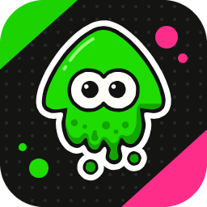
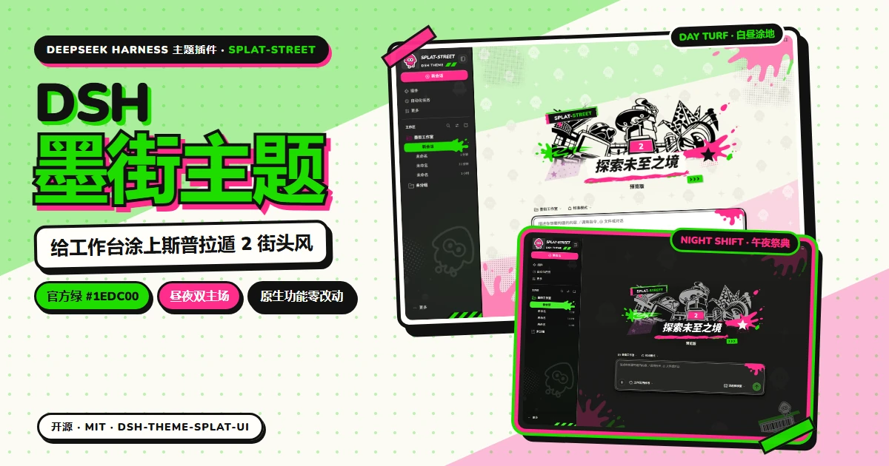
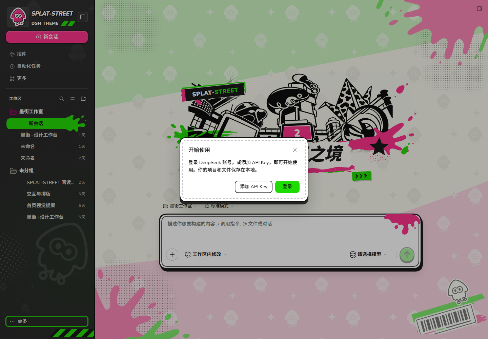
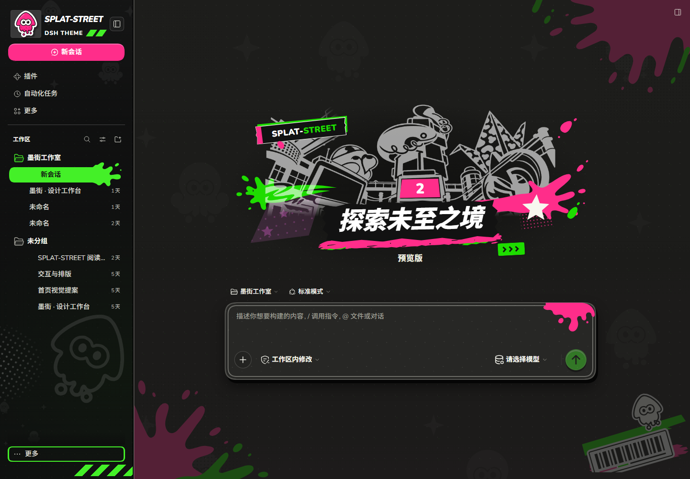
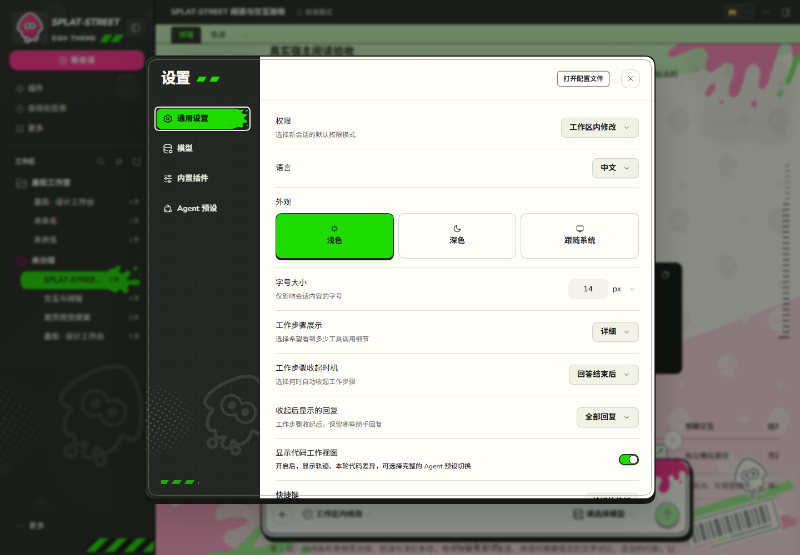
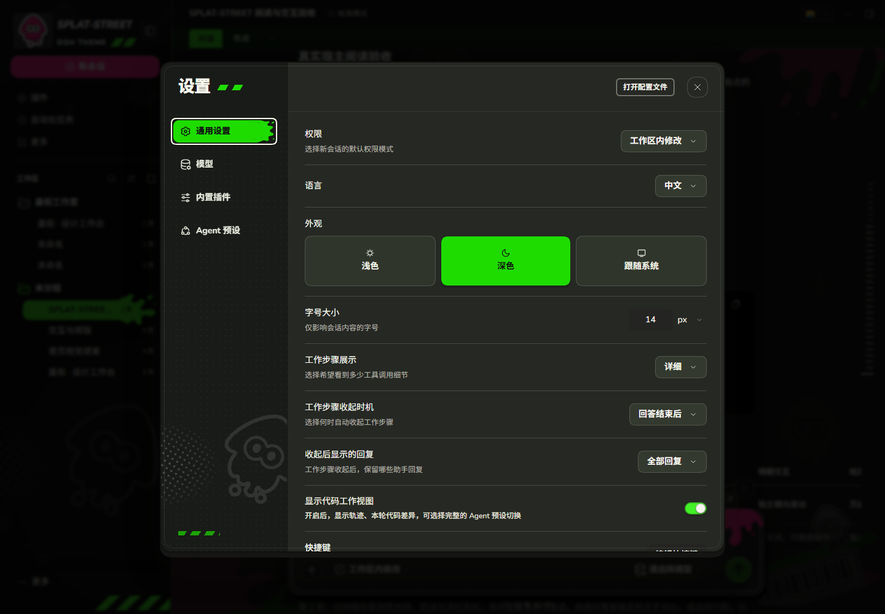
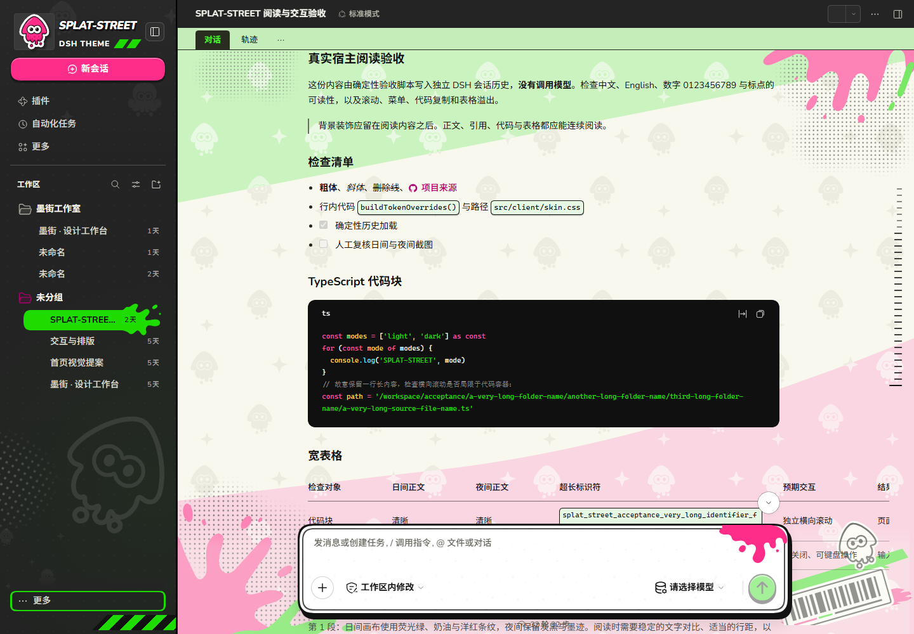
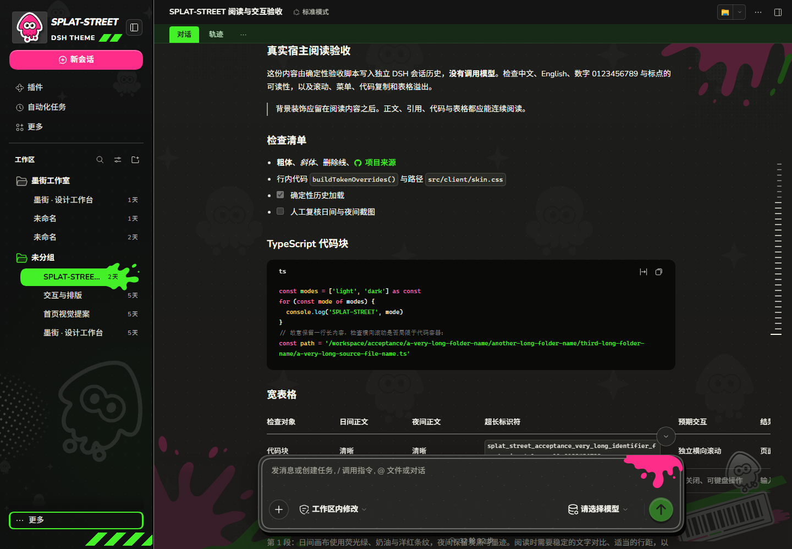
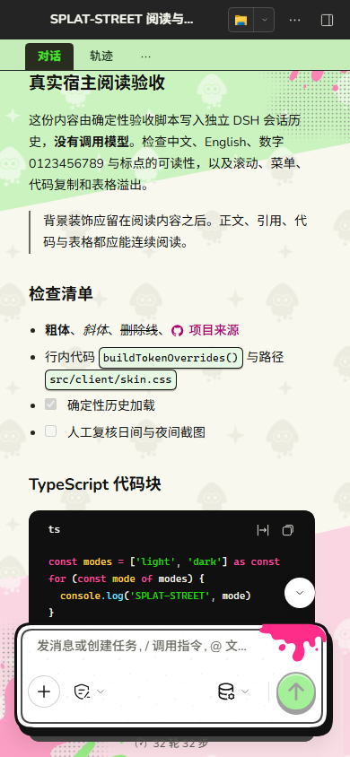
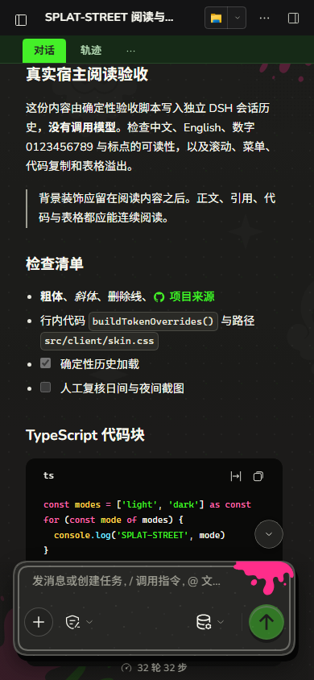

<div align="center">



# SPLAT-STREET · DSH 테마

[English](README.md) · [简体中文](README.zh.md) · [日本語](README.ja.md) · **한국어** · [쇼케이스 & 데모](https://shirolin.github.io/dsh-theme-splat-ui/) · 작성자: [Shirolin](https://github.com/Shirolin)

[](https://github.com/Shirolin/dsh-theme-splat-ui/actions/workflows/check.yml)
[](https://shirolin.github.io/dsh-theme-splat-ui/)
[](CHANGELOG.md)
[](https://www.npmjs.com/package/dsh-theme-splat-ui)
[](docs/compatibility.md)
[](LICENSE)

[](package.json)
[](package.json)
[](package.json)
[](package.json)
[](package.json)
[](docs/compatibility.md)

</div>

`SPLAT-STREET`는 스플래툰 2의 영역 배틀 감성을 바탕으로 만든 DeepSeek Harness(Web) 테마 플러그인입니다. 짙은 블랙 사이드바와 마젠타 '새 세션' 캡슐 버튼, 라임/크림/마젠타 3색 스트라이프 캔버스 위의 화이트 오징어 패턴·잉크 스플래시·망점 텍스처, 빈 세션 히어로 영역의 스트리트 일러스트, 스페셜 웨폰 게이지 스타일 부팅 로더, 마젠타 잉크가 흐르는 검은 테두리 컴포저 카드로 구성되어 있습니다. 다크 모드에서는 동일한 네온 잉크 컬러를 유지한 채 배경을 차콜 블랙 광장으로 전환합니다.

온라인 쇼케이스 및 컴포넌트 도감: https://shirolin.github.io/dsh-theme-splat-ui/

> [!NOTE]
> 본 프로젝트는 비공식 팬 테마이며 Nintendo 및 DeepSeek 공식과 어떠한 제휴나 보증 관계도 없습니다. 프로젝트 오리지널 벡터 오징어/문어 아트워크, 게임 스크린샷을 참고해 생성한 단색 광장 일러스트, 그리고 SVG 장식을 사용합니다. 에셋 출처와 라이선스 범위, 서드파티 고지는 [THIRD_PARTY_NOTICES.md](THIRD_PARTY_NOTICES.md)를 참고해 주세요. 플러그인은 DSH의 공개 ThemeRuntime 토큰과 Slot 확장 지점을 사용하며, 상위 업데이트 시에도 안전하게 폴백합니다.

---

## 미리보기



> 2026년 11월 20일, 격리된 실제 DSH `0.2.2-rc.1` Web 프로필에 로컬 `.tgz` 패키지를 설치해 재검증 및 캡처한 화면입니다. 첫 릴리스의 검증 범위는 Web입니다. 대화 내용은 결정적 검증용 히스토리이며 실제 모델 호출은 수행하지 않았습니다. 자세한 범위와 증빙은 [검증 기록](docs/acceptance.md)을 확인하세요.

<details>
<summary>펼쳐 보기: 라이트 / 다크 워크스페이스, 설정, 읽기 화면 및 390px 모바일 스크린샷</summary>

| 라이트 모드 (Light) | 다크 모드 (Dark) |
| --- | --- |
|  |  |
|  |  |
|  |  |
|  |  |

</details>

정적 컴포넌트 도감은 `site/showcase/index.html`(온라인 주소: https://shirolin.github.io/dsh-theme-splat-ui/showcase/ )에 있으며, 버전이 고정된 DOM 픽스처와 실제 DSH CSS로 생성되었습니다. 스페셜 게이지 부팅 화면과 엣지 케이스도 도감에서 확인할 수 있습니다.

---

## 설계 및 주요 기능

- **주야간 두 가지 배틀필드**: 라이트 모드는 라임/크림/마젠타 3색 스트라이프 위에 흰색 오징어 스탬프, 잉크 스플래시, 망점, 우측 하단 오징어 바코드 스티커를 배치합니다. 다크 모드는 차콜 배경 위에 어둡게 톤 다운된 스플래시와 오징어 패턴을 깔아 네온 강조색을 살립니다.
- **홈 터프 사이드바**: 짙은 블랙 배경, 투명 브랜드 헤더(마젠타 오징어 + 화이트 `SPLAT-STREET` + 라임 사선 스트라이프), 독립된 마젠타 새 세션 버튼, 잉크 꼬리가 달린 라임 선택 행(가독성을 위한 검은 글씨), 하단 해저드 스트라이프와 하드 오프셋 섀도우.
- **히어로 씬 & 스페셜 게이지 부팅 로더**: Inkopolis Square 게임 스크린샷을 참고해 생성·압축한 투명 PNG 광장 일러스트를 SVG에 삽입하고 `2` 사인, `SPLAT-STREET` 테이프, 잉크 장식(야간에는 좌우 오징어 추가)과 `>>>` 속도 블록을 배치했습니다. 부팅 카드는 상단 오징어 실을 유지하면서 진행 링을 24분할 스플래툰 스페셜 웨폰 게이지 디자인으로 구현했습니다.
- **컴포저**: 2.5px 검은 테두리와 내부 헤어라인, 망점, 하드 섀도우, 우상단 마젠타 잉크 드립. 첨부 버튼은 종이 디스크, 전송 버튼은 마젠타 리플이 들어간 라임 원형 버튼입니다.
- **외관 설정**: `설정 → 플러그인 → 墨街外观` 탭에서 페이퍼 20% / 밸런스 50% / 터프 100% 프리셋, `0%–100%` 캔버스 잉크 농도 슬라이더(`--splat-canvas-veil` 매핑), 3종 메인 그린 프리셋(기본 오피셜 `#1edc00` / 네온 `#9ae528` / 라임 `#d3f510`), diff 구문(네온/네이티브), 장식·망점·폰트 토글 및 초기화를 제공합니다. 설정은 클라이언트 `localStorage`에 저장됩니다.
- **빌드 타임 에셋 내장**: Nunito Latin WOFF2(400–900) 및 테마의 SVG·PNG 에셋은 빌드 시 `lib/client.js`에 내장되므로 런타임에 외부 다운로드가 필요하지 않습니다.

---

## 설치

하나의 프로필에는 테마 플러그인을 하나만 활성화하는 것을 권장합니다.

### npm으로 설치(권장)

```sh
cd <DSH_Profile_dir>
pnpm add dsh-theme-splat-ui
```

설치 후 DSH 서비스(또는 데스크톱 앱)를 완전히 재시작하고 페이지를 새로고침하세요.

### GitHub Release / 오프라인 `.tgz`

[GitHub Releases](https://github.com/Shirolin/dsh-theme-splat-ui/releases)에서 `dsh-theme-splat-ui-<version>.tgz`를 내려받거나(또는 저장소에서 `pnpm run release 0.1.0` 실행) 설치합니다:

```sh
cd <DSH_Profile_dir>
pnpm add file:<download-dir>/dsh-theme-splat-ui-<version>.tgz
```

### 저장소에서 직접 설치

```sh
pnpm install
pnpm run build
cd <DSH_Profile_dir>
pnpm add file:<absolute-path-to-this-repo>
```

`cordis.patch.yml`이 프로필의 플러그인 목록에 패키지를 마운트하며, `package.json`의 `dsh.client.inject`가 Theme / Renderer / Sidebar / Conversation 의존 순서를 선언합니다.

---

## 개발 및 검증

요구 환경: **Node.js ≥ 22.13.0**, **pnpm 11.1.2** (주요 툴체인: `TypeScript 5.8.2`, `esbuild 0.25.6`, `Biome 2.6.4`, `lightningcss 1.29.2`). 자세한 내용은 [CONTRIBUTING.md](CONTRIBUTING.md)를 참고하세요.

```sh
pnpm install --frozen-lockfile
pnpm run check          # 사이트 검사 + 타입 체크 + 빌드 + 테스트 + DSH 호환성 검사
pnpm run format:check   # Biome 포맷 확인
pnpm run lint           # Biome 정적 분석
pnpm run check:fixtures -- --expect-dsh 0.2.2-rc.1
pnpm run showcase       # site/showcase/generated/ 재생성
pnpm run audit          # 커버리지 진단
pnpm run release 0.1.0
pnpm run install:local -- --dry-run
```

`pnpm run demo`는 디자인 데모를 `artifacts/demo/`에 출력하며, 실제 호스트 문서 스크린샷을 덮어쓰지 않습니다.

서브패스 내보내기:

```ts
import { SPLAT_UI_PALETTES } from 'dsh-theme-splat-ui/palette'
import { buildTokenOverrides, contrastRatio } from 'dsh-theme-splat-ui/tokens'
```

---

## 문서

- [디자인 언어 및 스타일 경계 (docs/design.md)](docs/design.md): 레이어 구조, 메인 그린 프리셋, 대비 기준
- [DSH 호환성 규약 (docs/compatibility.md)](docs/compatibility.md): 공개 Slot, `data-*` / ARIA 접점 및 폴백 매트릭스
- [검증 범위 및 증빙 (docs/acceptance.md)](docs/acceptance.md): 실제 DSH `0.2.2-rc.1` Web 검증 결과 및 스크린샷 범위
- [변경 로그 (CHANGELOG.md)](CHANGELOG.md): 버전별 변경 및 수정 이력
- [서드파티 고지 (THIRD_PARTY_NOTICES.md)](THIRD_PARTY_NOTICES.md): 오리지널 벡터 및 비-MIT 에셋 출처

---

## 기여 및 피드백

- PR 전 [CONTRIBUTING.md](CONTRIBUTING.md)를 읽고 접점 등록 규칙과 픽스처 검증 절차를 확인해 주세요.
- 버그 리포트나 제안은 [GitHub Issues](https://github.com/Shirolin/dsh-theme-splat-ui/issues)로 전달해 주세요.

---

## 라이선스

프로젝트 코드와 오리지널 벡터 에셋은 [MIT License](LICENSE)로 배포되며, Nunito 폰트는 SIL Open Font License 1.1([licenses/Nunito-OFL.txt](licenses/Nunito-OFL.txt))에 따라 배포됩니다. 기타 에셋 출처, MIT 제외 범위 및 서드파티 고지는 [THIRD_PARTY_NOTICES.md](THIRD_PARTY_NOTICES.md)를 확인하세요.

---

## 후원 및 관련 프로젝트

이 테마가 작업 환경을 더 즐겁게 만들어 준다면 저장소에 **Star**를 눌러주시거나 아래 채널을 통해 후원으로 응원해 주세요:

- **Afdian (爱发电)**: [https://ifdian.net/a/shirolin](https://ifdian.net/a/shirolin)
- **Ko-fi**: [https://ko-fi.com/shirolin](https://ko-fi.com/shirolin)
- **작성자의 다른 프로젝트**:
  - [Animal Island UI](https://github.com/Shirolin/dsh-theme-animal-island-ui) — 동물의 숲 감성 다이어리 스타일의 DeepSeek Harness 테마 플러그인.
  - [PostPress（印推）](https://github.com/Shirolin/postpress) — X(Twitter) 포스트와 스레드를 깔끔한 종이 카드 스타일로 변환하는 브라우저 확장 프로그램.
