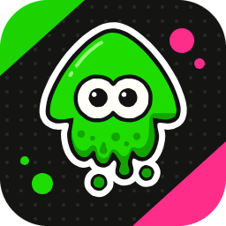
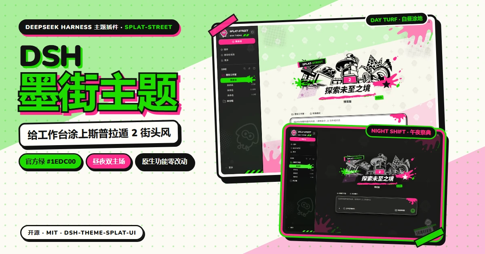
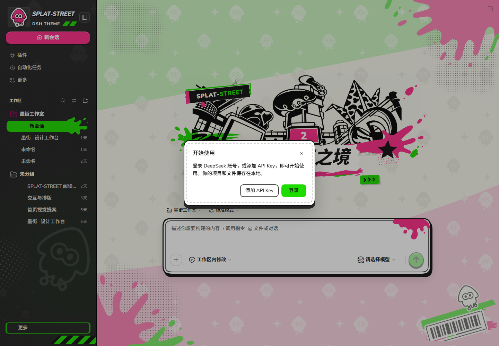
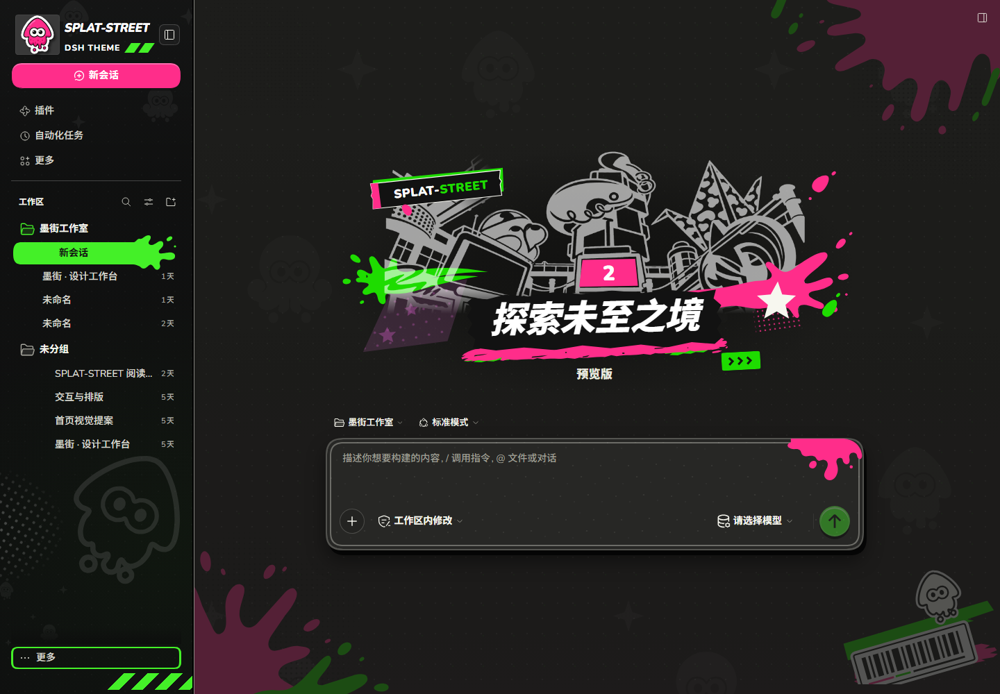
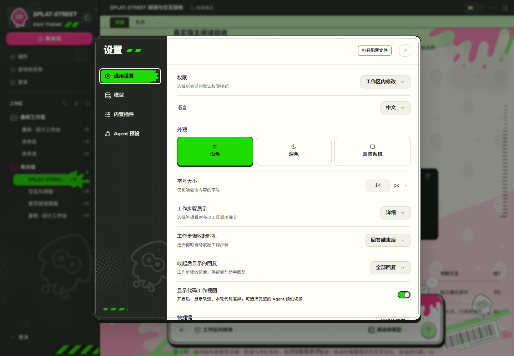
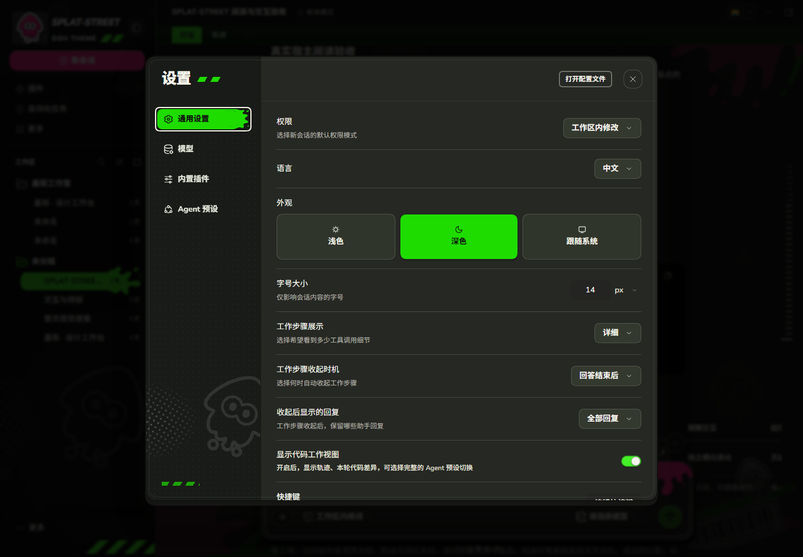
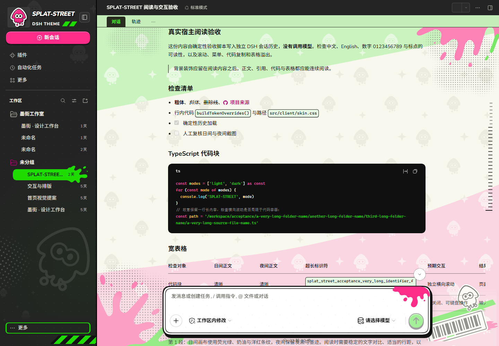
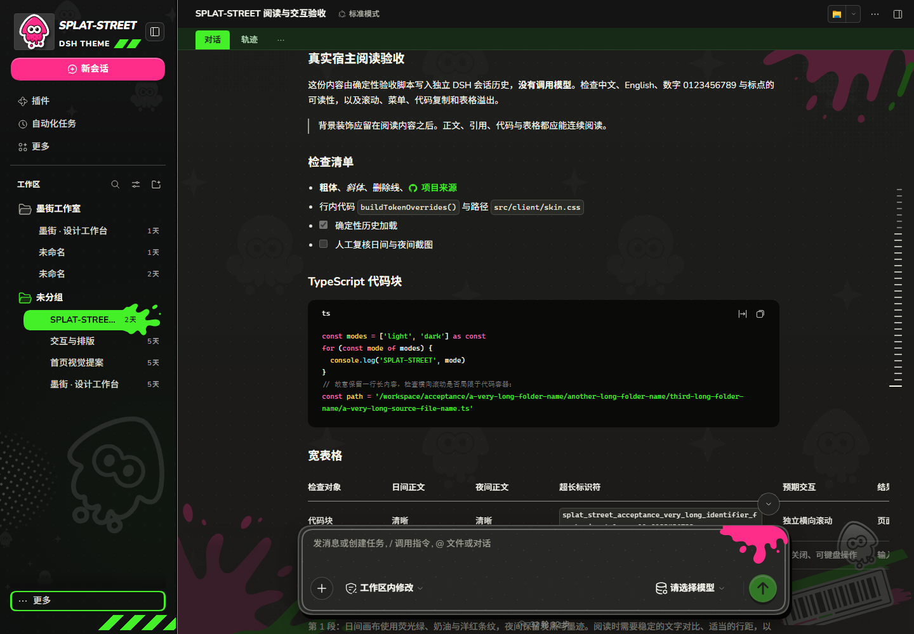
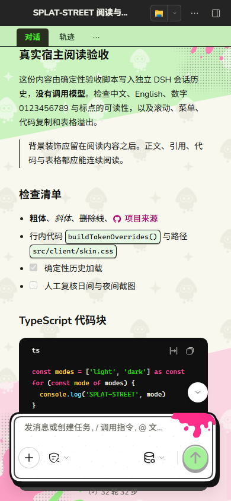
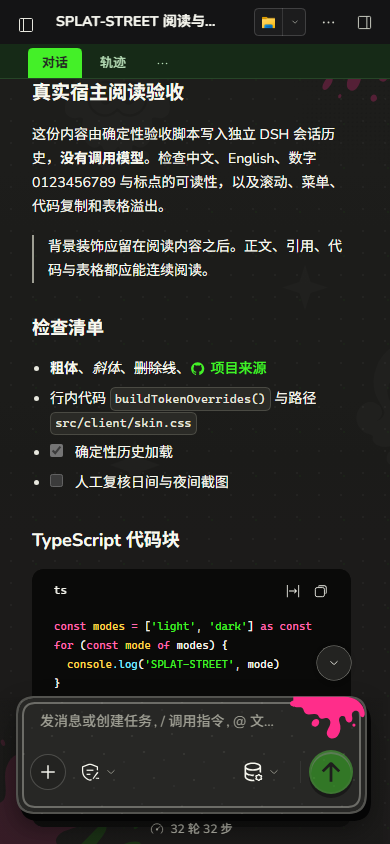

<div align="center">



# SPLAT-STREET · Theme for DSH

**English** · [简体中文](README.zh.md) · [日本語](README.ja.md) · [한국어](README.ko.md) · [Showcase & Live Demo](https://shirolin.github.io/dsh-theme-splat-ui/) · Author: [Shirolin](https://github.com/Shirolin)

[](https://github.com/Shirolin/dsh-theme-splat-ui/actions/workflows/check.yml)
[](https://shirolin.github.io/dsh-theme-splat-ui/)
[](CHANGELOG.md)
[](#installation-status)
[](docs/compatibility.md)
[](LICENSE)

[](package.json)
[](package.json)
[](package.json)
[](package.json)
[](package.json)
[](docs/compatibility.md)

</div>

`SPLAT-STREET` is a DeepSeek Harness (Web) theme plugin built on Splatoon 2's turf-war language: a near-black sidebar with a transparent masthead and a magenta new-session pill, a tri-band lime/cream/pink canvas with white squid stamps, magenta/lime splashes and halftone, a free-floating ink-battle scene for the empty-session hero, a Special Weapon Gauge boot loader, and a black-rimmed composer with a magenta ink drip. Night mode keeps the same neon ink on a charcoal plaza.

Live showcase & promo site: https://shirolin.github.io/dsh-theme-splat-ui/

> [!NOTE]
> Unofficial fan theme, not affiliated with or endorsed by Nintendo or DeepSeek. The theme uses original project vector squid/octopus artwork, a monochrome plaza illustration generated using an Inkopolis Square game screenshot as a reference, and SVG decorations. See [THIRD_PARTY_NOTICES.md](THIRD_PARTY_NOTICES.md) for asset sources, license boundaries, and third-party notices. The plugin consumes DSH's public ThemeRuntime tokens and slots and falls back safely across upstream updates.

---

## Preview



> Revalidated and captured on November 20, 2026 in real DSH `0.2.2-rc.1` Web after installing the local tarball into an isolated profile. The first release is validated for Web. The conversation is deterministic acceptance history; no model was called. See [acceptance scope and evidence](docs/acceptance.md).

<details>
<summary>Expand: Light / Dark workspace, settings, reading, and 390px mobile screenshots (real DSH DOM)</summary>

| Light Mode | Dark Mode |
| --- | --- |
|  |  |
|  |  |
|  |  |
|  |  |

</details>

The static component catalogue (`site/showcase/index.html`, live at https://shirolin.github.io/dsh-theme-splat-ui/showcase/) is built from version-pinned DOM fixtures and real DSH CSS. Boot screens (with the Special Weapon Gauge loader) and edge cases can be inspected there interactively.

---

## Design & Architecture

- **Two battlefields**: a tri-band lime/cream/pink field with white squid stamps, magenta/lime splashes, halftone and a bottom-right squid-barcode sticker by day; a charcoal canvas with the same splashes and squids dimmed at night.
- **Sidebar as home turf**: near-black surface, transparent brand masthead (magenta squid + white `SPLAT-STREET` + lime diagonal stripes), a separate magenta new-session pill, lime selected row with a splat tail and black type for contrast, a bottom hazard stripe, and hard offset shadows.
- **Hero & Special Gauge boot loader**: an SVG Hero composition embedding a compressed transparent PNG plaza illustration derived from an Inkopolis Square screenshot reference, layered with a `2` sign, `SPLAT-STREET` tape, and ink decorations (flanking squids at night), paired with a white outlined headline and `>>>` speed block; the boot card keeps the top squid seal and styles the live progress ring as a 24-segment Splatoon Special Weapon Gauge.
- **Composer**: 2.5px black rim with an inner hairline, halftone, hard shadow, magenta drip; a paper attach disc and a lime send disc with a magenta ripple.
- **Appearance tab**: `Settings → Plugins → Ink Street appearance` with Paper 20% / Balanced 50% / Turf 100% presets, a `0%–100%` positive canvas ink-intensity slider (mapped to `--splat-canvas-veil`), three ink green presets (default Official `#1edc00` / Neon `#9ae528` / Lime `#d3f510`), diff syntax (neon/native), décor, grain and font toggles, and reset. Preferences are stored in the client's `localStorage`.
- **Build-time assets**: Nunito Latin WOFF2 (400–900) and the theme's SVG and PNG assets are embedded in `lib/client.js`, requiring no external network downloads at runtime.

---

## Install

Keep only one theme plugin enabled per profile.

### Installation status

The npm release is currently on hold. The public repository, regular CI, and Pages showcase are available; npm installation will be enabled in a future release. Use a local `.tgz` package or install directly from this repository.

### Local release tarball

Build and verify the tarball in this repository first:

```sh
pnpm install --frozen-lockfile
pnpm run release 0.1.0
```

Then install it into an isolated DSH profile:

```sh
cd <DSH_Profile_dir>
pnpm add file:<repo>/artifacts/release-v0.1.0/dsh-theme-splat-ui-0.1.0.tgz
```

Restart the DSH service completely and reload the page.

### Offline `.tgz`

```sh
cd <DSH_Profile_dir>
pnpm add file:<download-dir>/dsh-theme-splat-ui-<version>.tgz
```

### From this repository

```sh
pnpm install
pnpm run build
cd <DSH_Profile_dir>
pnpm add file:<absolute-path-to-this-repo>
```

`cordis.patch.yml` mounts the package into the profile's plugin list; `dsh.client.inject` in `package.json` declares dependency ordering for Theme / Renderer / Sidebar / Conversation.

---

## Development

Requires **Node.js ≥ 22.13.0** and **pnpm 11.1.2** (toolchain pinned in `package.json`: **TypeScript 5.8.2**, **esbuild 0.25.6**, **Biome 2.6.4**, **lightningcss 1.29.2**).

```sh
pnpm install --frozen-lockfile
pnpm run check          # site check + typecheck + build + tests + DSH compat check
pnpm run format:check   # Biome formatting check
pnpm run lint           # Biome static lint
pnpm run check:fixtures -- --expect-dsh 0.2.2-rc.1
pnpm run showcase       # Rebuild site/showcase/generated/
pnpm run audit          # Coverage diagnostics
pnpm run release 0.1.0
pnpm run install:local -- --dry-run
```

`pnpm run demo` writes design demos to `artifacts/demo/` without overwriting real-host screenshots.

Subpath exports:

```ts
import { SPLAT_UI_PALETTES } from 'dsh-theme-splat-ui/palette'
import { buildTokenOverrides, contrastRatio } from 'dsh-theme-splat-ui/tokens'
```

---

## Documentation

- [Design Language & Palette Boundaries (docs/design.md)](docs/design.md): Layering, ink green presets, contrast gates, and component anatomy
- [DSH Compatibility Contract (docs/compatibility.md)](docs/compatibility.md): Public slots, `data-*` / ARIA seams, and fallback matrix
- [Acceptance Scope & Evidence (docs/acceptance.md)](docs/acceptance.md): Real DSH `0.2.2-rc.1` Web validation results and screenshot scope
- [Changelog (CHANGELOG.md)](CHANGELOG.md): Release and iteration notes
- [Third-Party Notices (THIRD_PARTY_NOTICES.md)](THIRD_PARTY_NOTICES.md): Original vector asset provenance and non-MIT boundaries

---

## Contributing & Security

- Read [CONTRIBUTING.md](CONTRIBUTING.md) before opening a pull request for seam registration rules, fixture commands, and release verification workflows.
- Please report bugs or regressions via [GitHub Issues](https://github.com/Shirolin/dsh-theme-splat-ui/issues).

---

## License & Attribution

Project source code and original vector artwork are licensed under the [MIT License](LICENSE). Bundled Nunito fonts are licensed under the [SIL Open Font License 1.1](licenses/Nunito-OFL.txt). See [THIRD_PARTY_NOTICES.md](THIRD_PARTY_NOTICES.md) for non-MIT boundaries and asset attribution.

---

## Support & Related Projects

If this theme brightens up your coding sessions, consider starring the repository or supporting maintenance:

- **Afdian (爱发电)**: [https://ifdian.net/a/shirolin](https://ifdian.net/a/shirolin)
- **Ko-fi**: [https://ko-fi.com/shirolin](https://ko-fi.com/shirolin)
- **More from the author**:
  - [Animal Island UI](https://github.com/Shirolin/dsh-theme-animal-island-ui) — An Animal Crossing–inspired stationery theme plugin for DeepSeek Harness.
  - [PostPress（印推）](https://github.com/Shirolin/postpress) — A browser extension that formats X (Twitter) posts and threads into clean paper-styled cards.
