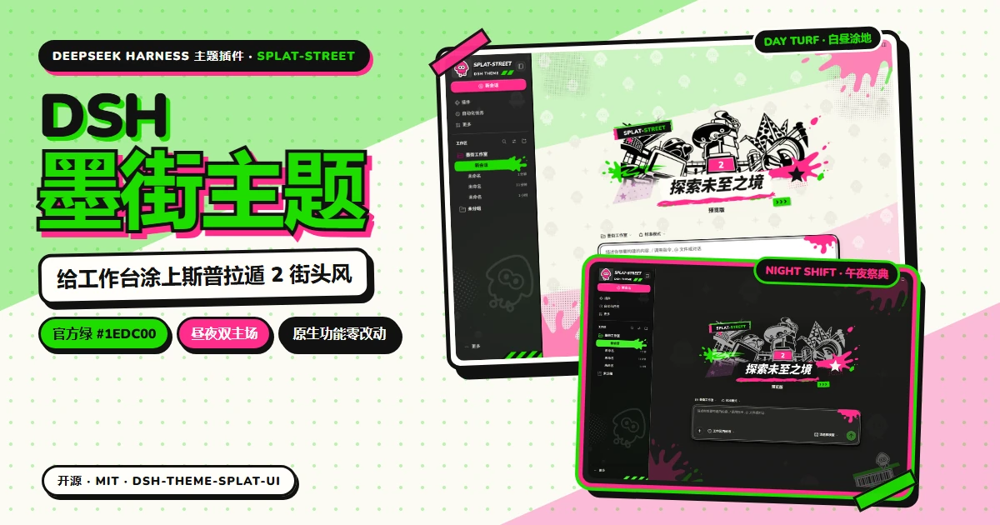
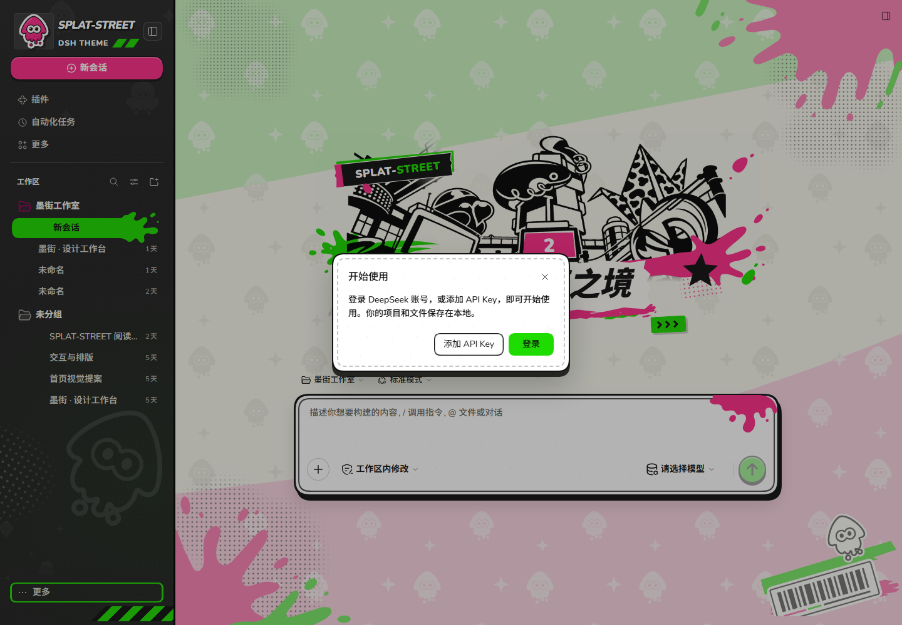
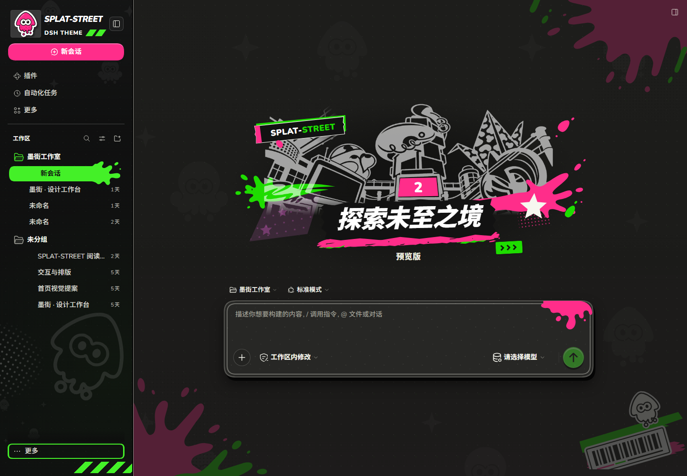
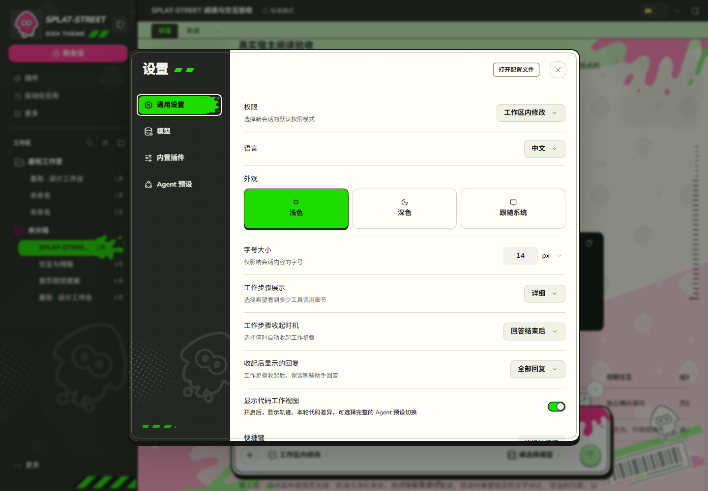
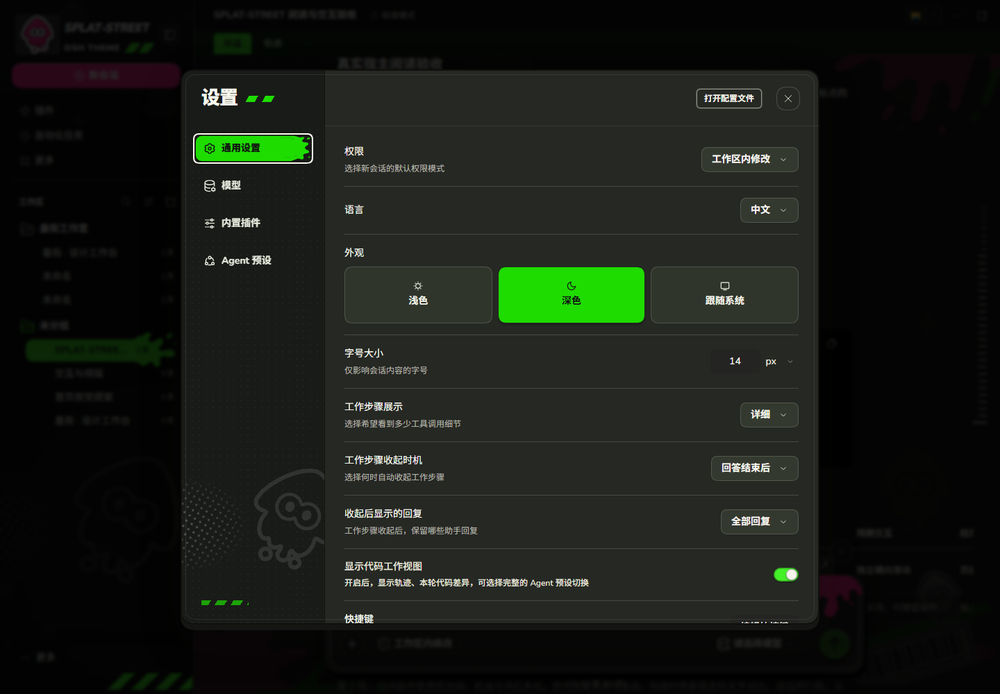
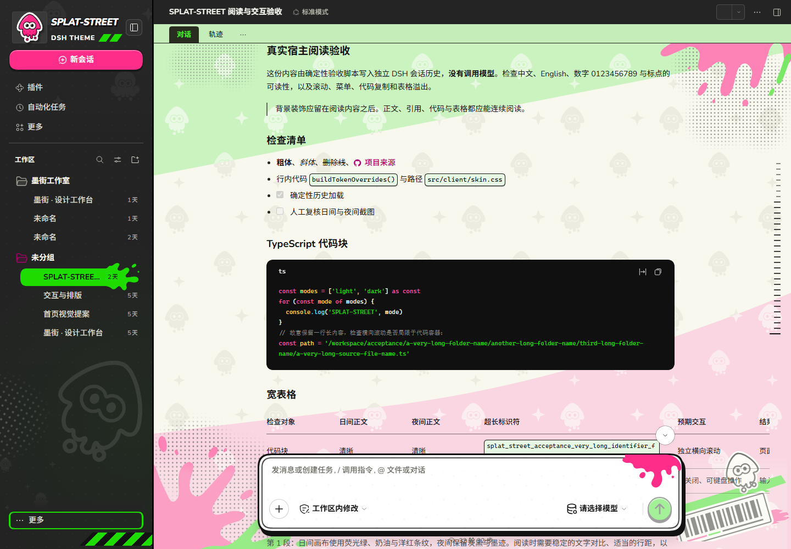
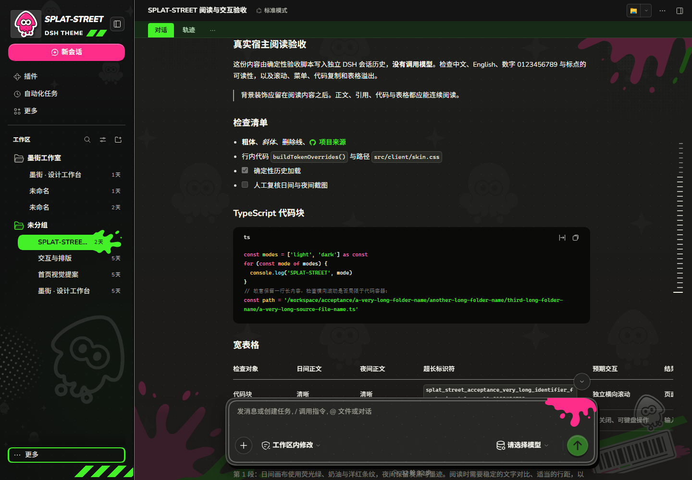
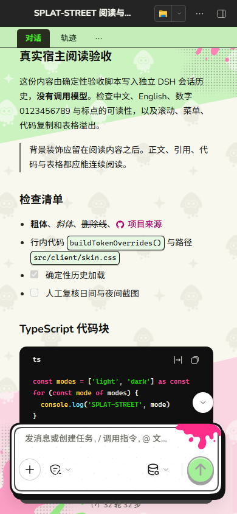
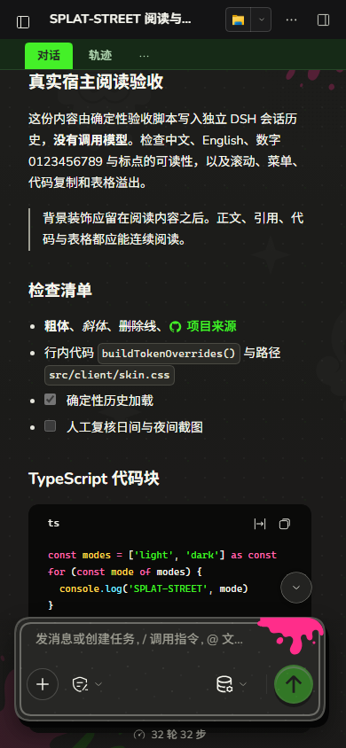

<div align="center">


# SPLAT-STREET · DSH 墨街主题

[English](README.md) · **简体中文** · [日本語](README.ja.md) · [한국어](README.ko.md) · [宣传页与组件图鉴](https://shirolin.github.io/dsh-theme-splat-ui/) · 作者：[Shirolin](https://github.com/Shirolin)

[](https://github.com/Shirolin/dsh-theme-splat-ui/actions/workflows/check.yml)
[](https://shirolin.github.io/dsh-theme-splat-ui/)
[](CHANGELOG.md)
[](https://www.npmjs.com/package/dsh-theme-splat-ui)
[](docs/compatibility.md)
[](LICENSE)

[](package.json)
[](package.json)
[](package.json)
[](package.json)
[](package.json)
[](docs/compatibility.md)

</div>

`SPLAT-STREET` 是 DeepSeek Harness（Web）的主题插件，用斯普拉遁 2 的涂地语言重绘工作台：近黑侧栏配洋红「新会话」胶囊，官方绿/奶油/洋红三色条纹画布铺白色鱿鱼纹、洋红/官方绿泼溅与网点，空会话 Hero 是一整幅自由漂浮的墨街插画，启动加载圈复刻特殊武器（大招）能量槽，Composer 是带洋红滴墨的黑色描边卡片。夜间模式保留同一套霓虹墨色，把广场换成炭黑。

在线展示与组件图鉴：https://shirolin.github.io/dsh-theme-splat-ui/

> [!NOTE]
> 非官方粉丝主题，与 Nintendo（任天堂）及 DeepSeek 官方无隶属或背书关系。主题使用项目原创矢量鱿鱼/章鱼素材、基于游戏截图参考生成的广场插画，以及 SVG 装饰；素材来源、授权范围与第三方声明见 [THIRD_PARTY_NOTICES.md](THIRD_PARTY_NOTICES.md)。插件仅消费 DSH 公开的 ThemeRuntime Token 与 Slot 接缝，上游升级后可安全降级回退。

---

## 界面预览



> 2026-11-20，在真实 DSH `0.2.2-rc.1` Web 隔离 profile 中，安装本地 `.tgz` 后重新验收与截图。会话是确定性验收历史，未调用模型。首版验收范围为 Web；检查范围、限制及证据见 [验收记录](docs/acceptance.md)。

<details>
<summary>展开查看：日间 / 夜间工作台、设置、阅读面与 390px 窄屏实拍（真实 DSH DOM）</summary>

| 浅色模式 (Light) | 深色模式 (Dark) |
| --- | --- |
|  |  |
|  |  |
|  |  |
|  |  |

</details>

真实 CSS 组件图鉴位于 `site/showcase/index.html`（在线访问：https://shirolin.github.io/dsh-theme-splat-ui/showcase/ ），基于版本固定的 DOM 夹具生成，可在其中交互查看大招能量槽启动卡及各状态边界。

---

## 设计与实现机制

- **昼夜两套战场**：日间是官方绿/奶油/洋红三色条纹画布，压着白色鱿鱼纹、洋红/官方绿泼溅与网点，右下角是白鱿鱼 + 条形码贴纸；夜间是炭黑画布，同一组泼溅与鱿鱼纹压暗后保留霓虹感。
- **侧栏即主场**：近黑底、透明品牌头（洋红鱿鱼 + 白色 `SPLAT-STREET` + 官方绿斜纹）、独立洋红「新会话」胶囊、官方绿选中行（右端带墨点尾）、底部危险条纹与硬偏移阴影。选中行用黑字，保证对比度。
- **Hero 场景与大招能量槽启动页**：SVG 场景中嵌入基于 Inkopolis Square 游戏截图参考生成的透明 PNG 广场插画，叠加 `2` 招牌、`SPLAT-STREET` 胶带与墨迹装饰（夜间两侧鱿鱼），搭配白色描边硬偏移标题与 `>>>` 速度块；启动页保留顶部鱿鱼印章，并将进度圈设计为 24 格斯普拉遁特殊武器（大招）能量槽。
- **Composer**：黑色 2.5px 描边 + 内圈细线、网点、硬阴影、右上洋红滴墨；附件是白纸圆盘，官方绿圆形发送键带洋红涟漪。
- **外观设置**：`设置 → 插件 → 墨街外观` 提供「纸白 20% / 均衡 50% / 涂地 100%」三档、`0%–100%` 正向画布墨度滑杆（自动映射到 `--splat-canvas-veil`）、三档主墨色（默认官方绿 `#1edc00` / 荧光绿 `#9ae528` / 黄绿 `#d3f510`）、diff 语法（霓虹/中性）、装饰/网纹/字体开关与重置。偏好保存在当前客户端的 `localStorage`。
- **构建期内嵌**：Nunito Latin WOFF2（400–900）及主题使用的 SVG、PNG 素材在构建时内嵌到 `lib/client.js`，运行时无需外部下载。

---

## 安装

同一 profile 下建议只启用一个主题插件。

### 通过 DSH CLI / npm 安装（推荐）

```sh
dsh plugin add dsh-theme-splat-ui
```

或进入你的 DSH profile 目录直接安装（已在 DSH Web `0.2.2-rc.1` 与 Windows Desktop `0.2.2-rc.5` 实机验证）：

```sh
cd <DSH_Profile_目录>
pnpm add dsh-theme-splat-ui
```

安装后完整重启 DSH 服务（桌面版请重启 DeepSeek Harness）并刷新页面。

### GitHub Release / 离线 `.tgz`

从 [GitHub Releases](https://github.com/Shirolin/dsh-theme-splat-ui/releases) 下载 `dsh-theme-splat-ui-<version>.tgz`（或在本仓库执行 `pnpm run release 0.1.0` 生成安装包）：

```sh
cd <DSH_Profile_目录>
pnpm add file:<下载目录>/dsh-theme-splat-ui-<version>.tgz
```

### 本仓库安装

```sh
pnpm install
pnpm run build
cd <DSH_Profile_目录>
pnpm add file:<本仓库绝对路径>
```

`cordis.patch.yml` 负责把包挂进 profile 的插件列表；`package.json` 的 `dsh.client.inject` 声明对 Theme / Renderer / Sidebar / Conversation 的依赖顺序。

---

## 开发与验证

环境要求：**Node.js ≥ 22.13.0**，**pnpm 11.1.2**（工具链版本：`TypeScript 5.8.2`、`esbuild 0.25.6`、`Biome 2.6.4`、`lightningcss 1.29.2`）。流程细节见 [CONTRIBUTING.md](CONTRIBUTING.md)。

```sh
pnpm install --frozen-lockfile
pnpm run check          # 完整门禁：站点检查 + 类型 + 构建 + 单元/契约测试 + DSH 兼容性核对
pnpm run format:check   # Biome 格式检查
pnpm run lint           # Biome 静态检查
pnpm run check:fixtures -- --expect-dsh 0.2.2-rc.1
pnpm run showcase       # 重新构建 site/showcase/generated/
pnpm run audit          # 覆盖率诊断
pnpm run release 0.1.0
pnpm run install:local -- --dry-run
```

`pnpm run demo` 仍可生成设计演示至 `artifacts/demo/`，不会覆盖真实宿主截图。

子路径导出：

```ts
import { SPLAT_UI_PALETTES } from 'dsh-theme-splat-ui/palette'
import { buildTokenOverrides, contrastRatio } from 'dsh-theme-splat-ui/tokens'
```

---

## 文档导航

- [设计语言与样式边界 (docs/design.md)](docs/design.md)：实现分层、主墨色预设、对比度门槛与部件设计
- [DSH 兼容性契约 (docs/compatibility.md)](docs/compatibility.md)：公开 Slot、`data-*` / ARIA 接缝清单与降级矩阵
- [验收范围与证据 (docs/acceptance.md)](docs/acceptance.md)：真实 DSH `0.2.2-rc.1` Web 全量验收记录与边界说明
- [版本变更日志 (CHANGELOG.md)](CHANGELOG.md)：各版本演进与修复记录
- [第三方与素材声明 (THIRD_PARTY_NOTICES.md)](THIRD_PARTY_NOTICES.md)：原创矢量与参考素材来源及授权边界

---

## 贡献与问题反馈

- 参与开发前请先阅读 [贡献指南 (CONTRIBUTING.md)](CONTRIBUTING.md)，了解接缝契约登记、夹具命令与发版校验流程。
- 欢迎通过 [GitHub Issues](https://github.com/Shirolin/dsh-theme-splat-ui/issues) 提交缺陷报告或改进建议。

---

## 许可与致谢

项目代码与原创矢量素材按 [MIT License](LICENSE) 分发；内嵌的 Nunito 字体遵循 [SIL Open Font License 1.1](licenses/Nunito-OFL.txt)。其余素材来源、非 MIT 范围与第三方声明见 [THIRD_PARTY_NOTICES.md](THIRD_PARTY_NOTICES.md)。

---

## 支持与相关项目

如果这套主题让你的日常编码环境更带感，欢迎点亮一颗 **Star**，或通过以下方式支持维护：

- **爱发电 (Afdian)**：[https://ifdian.net/a/shirolin](https://ifdian.net/a/shirolin)
- **Ko-fi**：[https://ko-fi.com/shirolin](https://ko-fi.com/shirolin)
- **作者的其他开源项目**：
  - [Animal Island UI](https://github.com/Shirolin/dsh-theme-animal-island-ui) —— 动物森友会手账风 DeepSeek Harness 主题插件。
  - [PostPress（印推）](https://github.com/Shirolin/postpress) —— 将 X（Twitter）推文与长串排版为纸质卡片的浏览器扩展。
